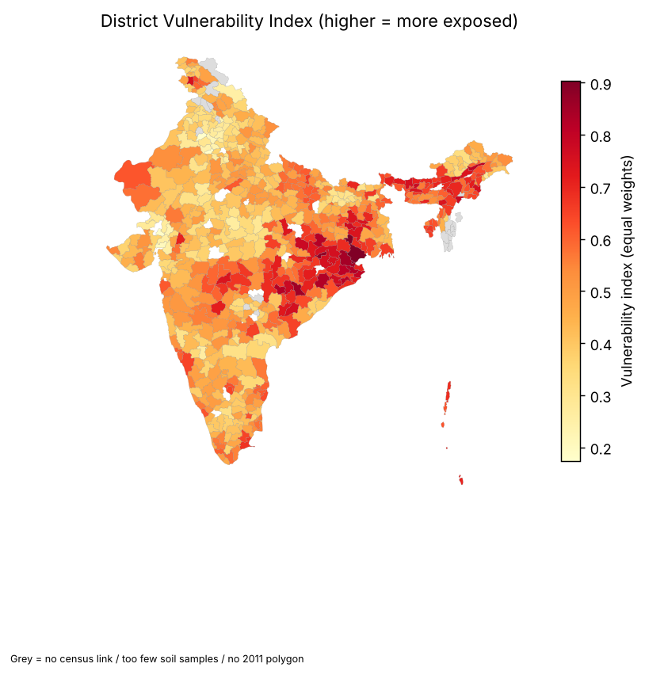
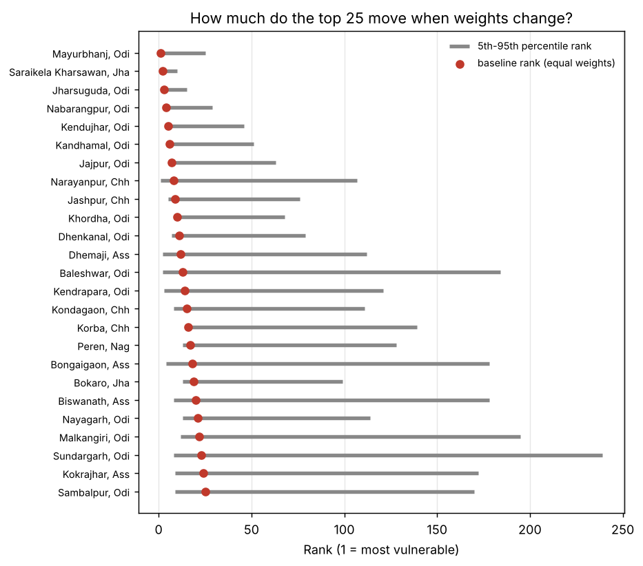
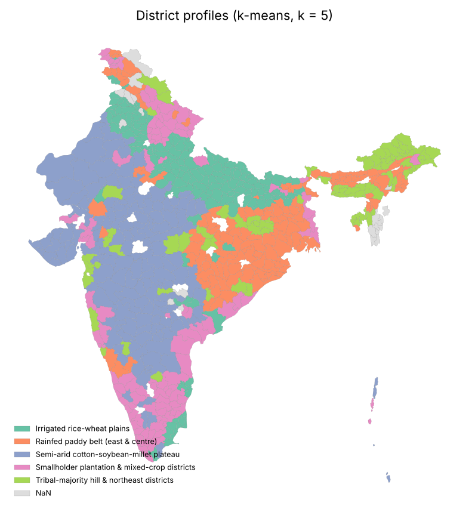

# Soil, Water and Crop Mismatch Atlas

A district-level analysis of Indian agriculture that asks: **where do soil health, irrigation access and cropping pattern work against each other, and which farmers are most exposed?**

It joins five public datasets from the Ministry of Agriculture & Farmers Welfare (about 17.7 million rows, 2.1 GB of CSV) into one district-level table, builds a transparent vulnerability index with an honest sensitivity analysis, groups districts into five profiles, and serves everything in an interactive Streamlit app.



**Status:** pipeline, index, clusters, app and tests are complete and reproducible from the raw files with `./run_all.sh`. The app is runnable locally and has not been deployed yet.

---

## Headline findings

All numbers below are produced by the pipeline (`data/processed/index_summary.json`, `cluster_profiles.csv`).

1. **The most exposed districts form a belt across eastern and central India.** Odisha holds 18 of the 50 highest-scoring districts, followed by Assam (8), Chhattisgarh (7), Jharkhand (4) and West Bengal (4). Mean index by state is highest in Odisha (0.73) and Assam (0.67), and lowest in Haryana (0.29) and Punjab (0.36). Forty-five of the top 50 are paddy-dominated.
   *Caveat:* 47 of the top 50 fall in the "rainfed paddy belt" profile, but that profile was built from the same features, so this is a consistency check, not independent confirmation.

2. **Rankings are stable at the top and uncertain in the middle.** Across 5,000 random weightings, a median 62% of the baseline top 50 stays in the top 50 (5th percentile: 36%). Only seven districts stay in the top 50 in at least 90% of draws: Mayurbhanj, Kendujhar, Nabarangpur, Kandhamal, Jharsuguda and Jajpur (Odisha) and Saraikela Kharsawan (Jharkhand). The top 20 have a median rank range of about 79 places across weightings, against about 342 for the median district.

   

3. **The four components measure different things.** Their pairwise Spearman correlations are all at most 0.28 in absolute value, so the weighting is a real analytical choice, not a detail.

4. **Soil and water stress are close to independent.** 32 of 668 ranked districts are in the top quarter on both (about 42 would be expected if they were independent), and 3 are also in the top quarter on equity exposure (Mayurbhanj, Kendujhar, Saraikela Kharsawan). Maharashtra has the most double-burden districts (10), then Odisha (6).

5. **Nitrogen is the dominant soil gap.** The median ranked district has 83% of samples low in nitrogen, 41% low in organic carbon, 31% boron-deficient and 28% zinc-deficient.

6. **Water stress and tribal/Scheduled Caste area share move together** (Spearman 0.47 on the raw features), consistent with the census finding that Scheduled Tribe farms are far less irrigated.

7. **Policy support looks thinner in tribal-majority hill districts.** Median area under MSP-listed crops is 62% there, against 91–95% in the plains, plateau and paddy-belt profiles. *This is a lower bound* (see data notes) and only describes crop mix, not whether farmers actually receive MSP.



| Profile | Districts | Median index | Typical states |
|---|---|---|---|
| Rainfed paddy belt (east & centre) | 152 | 0.66 | Odisha, Assam, Chhattisgarh, Jharkhand, West Bengal |
| Tribal-majority hill & northeast | 91 | 0.47 | Arunachal Pradesh, Meghalaya, Tripura |
| Irrigated rice-wheat plains | 157 | 0.45 | Uttar Pradesh, Bihar, Haryana, Punjab |
| Semi-arid cotton-soybean-millet plateau | 153 | 0.43 | Madhya Pradesh, Maharashtra, Rajasthan, Gujarat |
| Smallholder plantation & mixed-crop | 115 | 0.42 | Tamil Nadu, Kerala, Uttarakhand |

Cluster silhouette scores are low (0.17 to 0.18 for every k from 3 to 8): districts form a continuum, not cleanly separated groups, so profiles are a descriptive summary. Stability under resampling is good (adjusted Rand index about 0.87). Names describe the *typical* member, and individual districts can fit poorly.

## Data

| Dataset | Grain | Years | Rows |
|---|---|---|---|
| Soil Nutrient Analysis (Soil Health Card) | Village x nutrient x level | 2023-24, 2024-25 | 10,853,209 |
| Tehsil-level AgCensus Crop | Tehsil x social group x farm size x crop | 2010-11, 2015-16 | 6,495,760 |
| State-level AgCensus Crop | State x social group x farm size x crop | 2010-11, 2015-16 | 165,560 |
| Minimum Support Prices | Crop x year | 1998-99 to 2026-27 | 845 |
| Horticulture Area & Production | State x crop x year x estimate stage | 2011-12 to 2025-26 | 134,919 |

Sources (from the dataset codebooks): [Soil Health Card](https://soilhealth.dac.gov.in/nutrient-dashboard), [Agriculture Census](http://agcensus.dacnet.nic.in/nationalcharacteristic.aspx), [MSP statements](https://desagri.gov.in/statistics-type/latest-minimum-support-price-msp-statement/), [horticulture statistics](https://agriwelfare.gov.in/en/StatHortEst). District boundaries: [udit-001/india-maps-data](https://github.com/udit-001/india-maps-data) (2011 census boundaries).

The raw files are not committed. The horticulture and MSP files are loaded into Parquet but not used in the district index; they are available for extension.

## Method

1. **Ingest** (`src/ingest.py`): DuckDB converts the CSVs to Parquet (2.1 GB to about 80 MB) and checks row counts against an independent `wc -l`.
2. **Crosswalk** (`src/crosswalk.py`): soil districts (current names) matched to 2015-16 census districts, always within state. Tiers: exact name (641), curated rename table (10), same code with similar name (37), fuzzy (3). **691 of 738 districts (93.6%) match.** The 47 unmatched are almost all districts created after the census, plus Sheopur, which is missing from the 2015-16 file. They are kept for soil-only use but not ranked.
3. **Features** (`src/features.py`): soil stress (share of unhealthy samples over 12 parameters), water stress, equity exposure, crop concentration, MSP coverage.
4. **Index** (`src/index.py`): four components, each a percentile rank, combined with adjustable weights (equal by default), plus a Dirichlet-sampled weight sensitivity analysis. 668 districts are ranked (soil and census data present, at least 500 soil samples; these cover 94.9% of all soil samples).
5. **Clusters** (`src/cluster.py`): k-means on nine percentile-ranked features, k chosen by silhouette and resampling stability.
6. **Map and app** (`src/geo_join.py`, `app/main.py`): 665 of 691 census-linked districts (96.2%) have a polygon.

| Component | Definition |
|---|---|
| Soil | Mean share of unhealthy samples: Low (N, P, K, organic carbon), Deficient (B, Cu, Fe, Mn, S, Zn), Acidic (pH), Saline (EC) |
| Water | 100 minus irrigated share of gross cropped area |
| Equity | Mean rank of (Scheduled Tribe + Scheduled Caste share of area) and (marginal-holding share of holdings) |
| Crop | Herfindahl concentration of area across individual crops |

**Equity measures who is exposed, not how weak a district is.** That is a design choice, which is why the weights are adjustable.

## Data issues found and how they were handled

- **Seasonal paddy double counts paddy.** In the census, Pre-Kharif + Kharif + Summer paddy codes (111, 121, 131) equal the Paddy code (101) to within 0.1% (48.24 vs 48.25 Mha nationally). They are excluded from crop-mix features; a test guards this.
- **Census district codes are unreliable.** Codes are reused for different districts (Firozepur, Rupnagar and Sangrur all carry 031) and 10 district names appear under more than one code. Names are the primary key and codes are only supporting evidence.
- **DuckDB's CSV auto-detection broke on quoted commas** (for example `"Khalega, Metengliang"`). The quote character is now set explicitly, with row counts reconciled.
- **The 2010-11 state-level file omits seven states** (UP, MP, Rajasthan, Karnataka, Tamil Nadu, Tripura, Puducherry), and 2010-11 tehsil totals disagree with it by more than 50% in a few states. All district features use 2015-16.
- **MSP coverage is a lower bound.** Arhar/Tur, mustard and sesamum have no separate census code. Sugarcane carries an FRP, not an MSP, and is kept separate.
- **Soil coverage grew from 29 states (2023-24) to 32 (2024-25)** and the sample count roughly doubled, so shares are used, never counts, and each district uses its latest year.

## Limitations

- **Associations only.** Nothing here supports causal claims about soil, yield or policy.
- **The data are years apart.** Soil is 2023-25, the census 2010-16. The project matches structure, not one moment. Districts have been reorganised since, and Sikkim's four census districts map only approximately to the current ones.
- **Boundaries are 2011 vintage,** so newer districts have no polygon on the map.
- **No prices, incomes or yields,** so no economic-return analysis.
- **The index reflects design choices** (percentile ranks, four components, equal default weights). The sensitivity analysis quantifies that dependence but cannot remove it.
- **Soil is village-level but the census is tehsil-level,** so analysis stops at the district.

## Run it

```bash
git clone <repo-url> && cd <repo>
python -m venv .venv && source .venv/bin/activate
pip install -r requirements.txt
# put the five unzipped CSVs in data/raw/ (names as in the zip files), then:
./run_all.sh                      # ingest, crosswalk, features, index, clusters, map join, figures, tests
streamlit run app/main.py         # the app needs only data/processed/
```

To deploy, push the repo (including `data/processed/`) to Streamlit Community Cloud with `app/main.py` as the entry point.

## Repository layout

```
src/        ingest, crosswalk, features, index, cluster, geo_join, figures, download_boundaries
app/        Streamlit app (map, ranking, district profile, profiles, method)
tests/      pipeline integrity tests (10)
data/processed/   district feature, index and cluster tables, crosswalks, map GeoJSON
docs/       data dictionary, figures
```

See `docs/data_dictionary.md` for every column of the final table and `PROJECT_SCOPE.md` for the plan this followed.

## License and attribution

Data belongs to the Ministry of Agriculture & Farmers Welfare, Government of India; check each source's terms before redistributing. Boundaries from udit-001/india-maps-data. Code: `TODO: choose a licence (e.g. MIT)`.

## Author

`TODO: name, LinkedIn, contact`

## Additional analyses (`src/extras.py`, needs `requirements-pipeline.txt`)

- **Spatial hotspots:** Moran's I and local indicators (LISA, 6 nearest neighbours, 999 permutations) on the equal-weight index.
- **Within-district irrigation gap:** irrigated share of non-ST minus ST cropland (districts with at least 2,000 ha of ST cropland).
- **MSP exposure:** area-weighted yearly MSP growth since 2014-15 for a district's MSP-listed crops (lower-bound coverage).
- **Soil confidence interval:** normal approximation on `soil_stress`; ignores village-level clustering.
- **Nitrogen mismatch:** share of area in nitrogen-hungry crops (assumed: paddy, wheat, maize, cotton, sugarcane) x share of nitrogen-low samples.

Results are written to `data/processed/extras_summary.json`. A Dockerfile and a GitHub Actions test workflow are included.

## Change over time (`src/change.py`)

- **Census 2010-11 to 2015-16:** state-level change in irrigated share and marginal-holding share (28 common states), and district-level change for districts with an unchanged name. Districts whose cropped area moved by more than 40% (or under 2,000 ha) are dropped as likely coverage artefacts, which leaves 348 of 620.
- **Soil 2023-24 to 2024-25:** change in the share of unhealthy samples per district and parameter (at least 100 samples in both years). Only one year apart, with different villages sampled, so this is read as no detectable trend.
